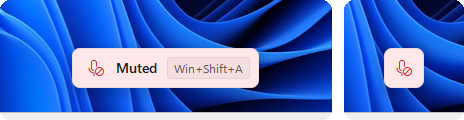
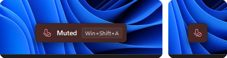

<p align="center">
  
</p>

<h1 align="center">mutekey</h1>

<p align="center">
  Mute your microphone from anywhere with <kbd>Win</kbd>+<kbd>Shift</kbd>+<kbd>A</kbd>.<br>
  A small Windows tray app that brings back the microphone half of the Video Conference Mute
  feature PowerToys removed in 0.88.
</p>

<p align="center">
  <a href="https://github.com/rodrigohpalmeirim/mutekey/releases/latest"><b>Download</b></a> ·
  <a href="#use">Use</a> ·
  <a href="#settings">Settings</a> ·
  <a href="#build">Build</a>
</p>

<p align="center">
  
  <br>
  
</p>

## Features

- **One shortcut, every app.** The shortcut mutes every microphone in Windows itself, so
  Teams, Zoom, Meet, Discord and everything else go quiet at once, whether or not they're
  focused.
- **A badge while you're muted.** It stays on top without stealing focus, and clicks go
  through it. Choose from six positions and a full or compact (icon only) style.
- **A tray icon that tells the truth.** It shows the real state, including mutes made in
  Windows settings or by other apps, and notices microphones being plugged in. Click it to
  toggle.
- **Never hides a live mic.** mutekey only says "muted" when *every* microphone is muted.
- **Looks at home on Windows 11.** Fluent 2 styling, light and dark mode (switching live),
  and sharp at any display scaling.
- **Tiny.** A single ~400 KB executable. No installer, no runtime, no admin rights.

## Install

1. Download `mutekey.exe` from the [latest release](https://github.com/rodrigohpalmeirim/mutekey/releases/latest).
2. Put it somewhere permanent, for example `%LOCALAPPDATA%\Programs\mutekey\`.
3. Run it. It starts with Windows from then on; untick **Start with Windows** in its menu
   to stop that.

The executable isn't code-signed, so SmartScreen may warn you the first time. Choose
**More info → Run anyway**. You can check the download against the `.sha256` file next to
it in the release.

mutekey is tested on Windows 11. Windows 10 should work but hasn't been tried.

**Coming from PowerToys?** Turn off Video Conference Mute (or upgrade past 0.87) first, so
the two don't both react to <kbd>Win</kbd>+<kbd>Shift</kbd>+<kbd>A</kbd>. mutekey only does
the microphone. There's no camera toggle.

## Use

| | |
|---|---|
| <kbd>Win</kbd>+<kbd>Shift</kbd>+<kbd>A</kbd> | Mute or unmute all microphones |
| Click the tray icon | Same |
| Right-click the tray icon | The menu below |

The menu:

- **Mute / Unmute**
- **Change shortcut…** Press the new combination. It needs <kbd>Win</kbd>, <kbd>Ctrl</kbd>
  or <kbd>Alt</kbd>; <kbd>Esc</kbd> cancels.
- **Badge position**: top or bottom; left, center or right. Picking one previews it.
- **Compact badge**: only the icon.
- **Start with Windows**
- **Exit**: unmutes first, so a muted mic is never left behind without the badge.


The tray icon on a light and a dark taskbar: live, muted, no microphone.

New tray icons start out hidden behind the **^** overflow on Windows 11. Drag mutekey's icon
onto the taskbar to keep it in sight.

## Settings

The menu saves everything to `%APPDATA%\mutekey\settings.ini`, which you can also edit by
hand (restart mutekey afterwards):

```ini
hotkey=Win+Shift+A
position=bottom-center
badge=full
start_with_windows=true
```

| Key | Values |
|---|---|
| `hotkey` | Modifiers (`Win`, `Ctrl`, `Alt`, `Shift`) plus a key: a letter or digit, `F1`–`F24`, `Space`, `Pause`, `Insert`, `Home`, `PageUp`, `Num0`–`Num9`, … |
| `position` | `top-left`, `top-center`, `top-right`, `bottom-left`, `bottom-center`, `bottom-right` |
| `badge` | `full` or `compact` |
| `start_with_windows` | `true` or `false`. Turning mutekey off in Task Manager's Startup apps is respected too. |

## How it works

- **The shortcut.** Windows 11 now reserves <kbd>Win</kbd>+<kbd>Shift</kbd>+<kbd>A</kbd>
  itself, so the usual `RegisterHotKey` fails. Like PowerToys did, mutekey watches the
  keyboard with a low-level hook and swallows the shortcut before Windows sees it. When the
  shortcut includes <kbd>Win</kbd> or <kbd>Alt</kbd>, mutekey sends a harmless extra
  keystroke so releasing it doesn't open the Start menu or an app's menu bar.
- **Muting.** mutekey calls `IAudioEndpointVolume::SetMute` on every active capture device,
  the same switch as the Windows sound settings. It reads the state again every 500 ms.
- **The badge.** A layered, topmost, click-through window. It's drawn with per-pixel alpha,
  so its edges are smooth and its shadow is soft, using Fluent 2's InfoBar and flyout colors.
- **The icons** are drawn by [`icons/make_icons.py`](icons/make_icons.py), one pixel size at
  a time, so they stay sharp at 16 px.

## Build

mutekey is Rust, built for the `x86_64-pc-windows-gnu` target. The CI cross-compiles from
Linux:

```bash
sudo apt install gcc-mingw-w64-x86-64      # linker and windres
rustup target add x86_64-pc-windows-gnu
cargo build --release --target x86_64-pc-windows-gnu
# target/x86_64-pc-windows-gnu/release/mutekey.exe
```

On Windows, use the same target with a MinGW-w64 toolchain (for example from
[MSYS2](https://www.msys2.org/)) so that `windres` is on `PATH`. The MSVC target isn't
set up yet.

To change the icons, edit `icons/make_icons.py` and run `python3 icons/make_icons.py`
(needs NumPy and Pillow). It rewrites the `.ico` files and writes a `preview.png`.

[`test/`](test/) has the scripts used to test mutekey by hand in a Windows VM.

## License

[MIT](LICENSE)
